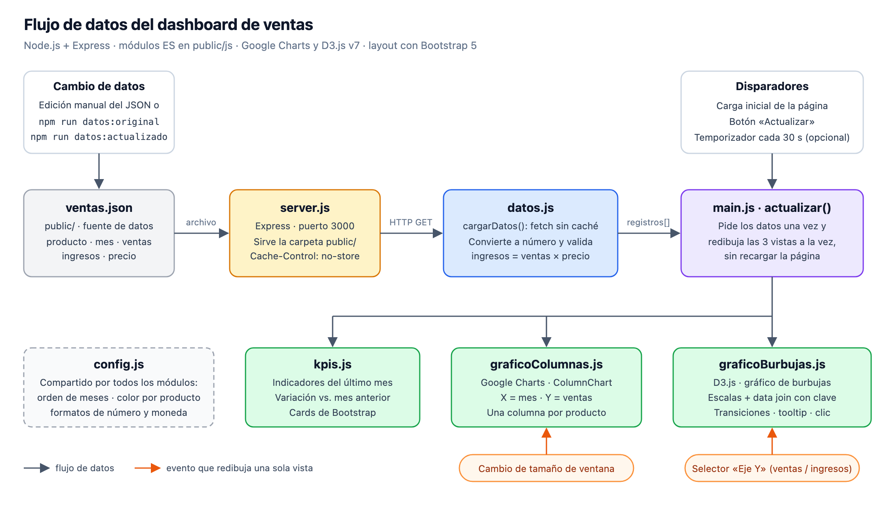

# Dashboard de ventas · Tarea 1 (JSON + Google Charts + D3.js)

Dashboard interactivo que lee `public/ventas.json` y muestra:

1. **KPIs**: unidades e ingresos del último mes comparados con el mes anterior, ingresos acumulados y producto líder.
2. **Google Charts**: gráfico de columnas de ventas mensuales por producto (eje X = mes, eje Y = unidades, una columna por producto).
3. **D3.js v7**: gráfico de burbujas multidimensional.
   - Dimensiones: X = mes, color = producto, Y = ventas o ingresos (selector) y tamaño = la otra métrica.
   - Animación: transiciones de entrada, actualización y salida.
   - Interacción: tooltip al pasar el ratón, y clic en una burbuja o en la leyenda para resaltar un producto.
4. **Botón «Actualizar»**: vuelve a leer el JSON y redibuja KPIs, Google Charts y D3 **a la vez, sin recargar la página**. Opcionalmente, hay un temporizador automático cada 30 s (casilla «Auto»).

## Diseño adaptable (Bootstrap 5)

El layout usa **Bootstrap 5.3** (por CDN). Las clases principales son:

| Elemento | Clases | Comportamiento |
|---|---|---|
| Gráficos | `row` > `col-12 col-lg-6` | Lado a lado desde 992 px; apilados en pantallas menores |
| KPIs | `row row-cols-2 row-cols-lg-4` | 4 por fila en escritorio; 2 por fila en móvil |
| Tarjetas | `card h-100 shadow-sm` | Misma altura dentro de cada fila |
| Controles | `btn btn-primary`, `form-select`, `form-check form-switch` | Botón Actualizar, selector de métrica e interruptor de auto-actualización |

Lo que Bootstrap no resuelve se hace en el propio código:

- **Gráfico de D3:** usa un `viewBox`, así que se escala al ancho de su tarjeta. En pantallas de menos de 576 px, `styles.css` agranda el texto del SVG para que siga siendo legible.
- **Gráfico de Google:** no se ajusta solo. `main.js` lo vuelve a dibujar cuando cambia el tamaño de la ventana.
- **Leyenda de Google en móvil:** cuando el gráfico mide menos de 480 px de ancho, Google recorta los nombres ("Smart…"). En ese caso se oculta su leyenda y se muestra una leyenda HTML con los mismos colores.

Para el informe conviene incluir dos capturas, una en escritorio y otra en ancho de móvil (DevTools → *Toggle device toolbar*).

## Cómo ejecutarlo

Requiere Node.js 18 o superior.

```bash
npm install
```

```bash
npm start
```

Abre http://localhost:3000. Para usar otro puerto: `PORT=3001 npm start`.

## Cómo probar la actualización (evidencia para el informe)

1. Arranca con los datos originales y toma la **captura 1**:

   ```bash
   npm run datos:original
   ```

2. Copia el juego con **marzo** a `public/ventas.json`. También puedes editar el archivo a mano: cambia ventas, ingresos o precio, o añade registros.

   ```bash
   npm run datos:actualizado
   ```

3. Pulsa **Actualizar** en el navegador (o espera al temporizador) y toma la **captura 2**. La línea de estado muestra cuántos registros se leyeron y la hora de la lectura.

Mantén `ingresos = ventas × precio`. Si un registro no cuadra, aparece un aviso en la consola del navegador.

## Estructura

```
dashboard-ventas/
├── server.js               Express: sirve public/ y entrega el JSON sin caché
├── package.json            scripts: start, datos:original, datos:actualizado
├── scripts/usar-datos.js   copia un juego de datos a public/ventas.json
├── datos/
│   ├── ventas_original.json     los 6 registros de la actividad (ene–feb)
│   └── ventas_actualizado.json  + marzo, con ventas, ingresos y precio coherentes
├── docs/
│   └── diagrama-flujo-datos.svg / .png   diagrama para el informe
└── public/
    ├── index.html          layout con Bootstrap 5: cabecera, botón, KPIs, 2 cards de gráficos
    ├── styles.css          solo estilos SVG de D3, tooltip y leyenda
    ├── ventas.json         fuente de datos que lee el dashboard
    └── js/                 módulos ES, uno por responsabilidad
        ├── main.js             punto de entrada: actualizar(), botón, temporizador, resize
        ├── config.js           meses, color por producto, formatos de número
        ├── datos.js            capa de datos: fetch sin caché, validación, meses/productos
        ├── kpis.js             indicadores
        ├── graficoColumnas.js  Google Charts
        └── graficoBurbujas.js  D3.js
```

## Arquitectura y flujo de datos



Cada módulo cubre una parte de la rúbrica:

| Criterio de la rúbrica | Módulo |
|---|---|
| Manejo de datos y actualización | `datos.js` (carga y validación) + `main.js` (botón y temporizador) |
| Visualización básica (Google Charts) | `graficoColumnas.js` |
| Visualización multidimensional (D3.js) | `graficoBurbujas.js` |
| Integración de la interfaz | `index.html` (Bootstrap) + `main.js` (redibuja todo a la vez) |

**Reglas de la separación:**
- Ningún gráfico lee el JSON por su cuenta. Solo `datos.js` sabe de dónde vienen los datos, y cada vista recibe los registros como parámetro.
- `config.js` centraliza los colores por producto, así que Google Charts, D3 y las leyendas usan exactamente los mismos.

Los módulos se cargan con `<script type="module" src="js/main.js">`. No necesitan ninguna herramienta de compilación, pero sí el servidor: los módulos ES no funcionan abriendo el HTML con `file://`.

## Lógica de actualización (resumen para el informe)

- `cargarDatos()` (en `datos.js`) hace `fetch("ventas.json?t=<hora>", { cache: "no-store" })`. El servidor también responde con `Cache-Control: no-store`, así que cada lectura trae el archivo actual y no una copia guardada. Después convierte los campos a número y descarta los registros inválidos.
- `actualizar()` (en `main.js`) llama en orden a `dibujarKPIs()`, `dibujarColumnas()` y `dibujarBurbujas()`. La usan:
  - la carga inicial (`google.charts.setOnLoadCallback`);
  - el botón «Actualizar»;
  - el temporizador (`setInterval`).
- **Google Charts**: se construye un `DataTable` nuevo (filas = meses, columnas = productos) y se vuelve a llamar a `chart.draw()`, con animación de 800 ms.
- **D3**:
  - Los dominios de las escalas (`scaleBand`, `scaleLinear` y `scaleSqrt`) se recalculan con los datos nuevos, y los ejes se redibujan con una transición.
  - Las burbujas se enlazan con `.data(datos, d => producto|mes)` y `.join()`. Las que ya existían se desplazan a su nueva posición, las nuevas (p. ej., marzo) crecen desde el eje X y las que desaparecen se encogen hasta borrarse.

## Storytelling de los datos

**Datos originales (enero → febrero):**

- Las unidades suben de 265 a 310 (+17,0 %) y los ingresos de $59 000 a $69 000 (+16,9 %).
- Smartphone A explica 6 000 de los 10 000 de aumento (de 120 a 150 u., +25 %).
- Tablet X vende menos unidades, pero su precio ($300) le da más ingresos que Smartphone B.
- Smartphone B es el que menos crece (+5,9 %).

**Con marzo (datos de ejemplo):**

- Smartphone A baja su precio a $180 y Tablet X a $280.
- Las unidades suben a 340 (+9,7 %), pero los ingresos solo +4,8 % ($72 300), porque el descuento reduce el ingreso por unidad.
- Tablet X es la que más crece: 70 → 95 u. (+36 %).
- Smartphone B cae a 80 u. (−11 %). Es una señal de alerta: valdría la pena revisar su precio o su promoción.
